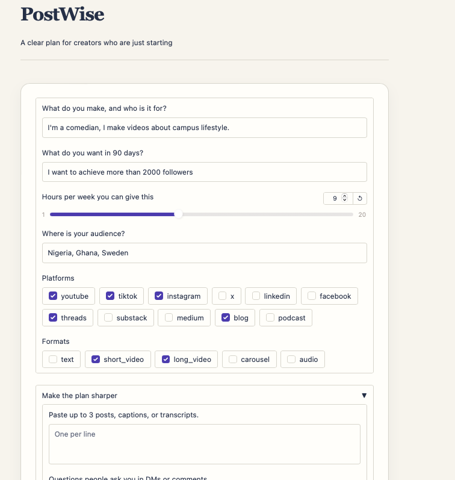
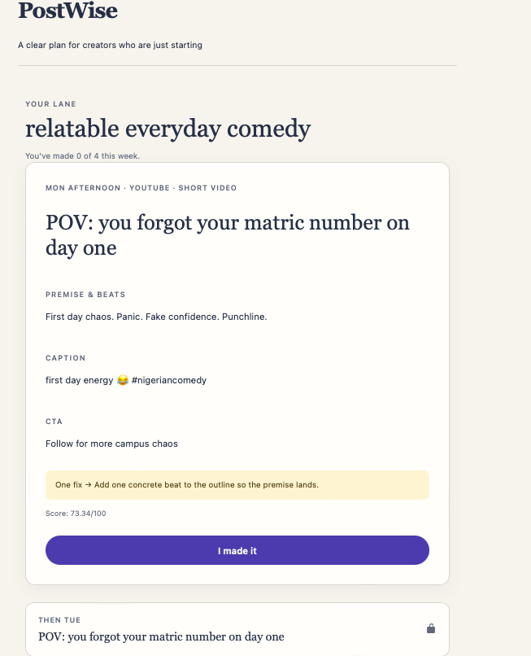

# Postwise
### A clear plan for creators who are just starting.

**Team:** Binary Minds
**Event:** OPEN//BUILD 2026 · OSCA Ile-Ife Hacktoberfest Challenge

**🔗 Live Demo:** [INSERT YOUR DEPLOY LINK HERE]
*(If the live link is down or slow due to free-tier limits, see the "Run Locally" section below).*

---

## 1. The Problem
Most beginner creators post without a plan. They don't know what to make, when to post, or whether it's working. 

The cause isn't a lack of creativity. It's the absence of scalable, goal-driven guidance. Industry surveys report that **69% of creators are financially unstable**, **59% of beginners never monetize**, and **62–79% report burnout**. Existing tools mostly report *what already happened* (analytics) or assume you already have an audience and connected accounts. A beginner has neither.

**Who it affects:** Anyone who makes content and has to decide what to make next — writers, video creators, comedians, designers, and podcasters. We serve the **pre-production layer**: the thinking before the camera, the keyboard, or the mic.

---

## 2. The Solution
Postwise turns the three guesses creators make every day — *what to make, when to make it, and whether it worked* — into three clear decisions.

Users answer **5 required questions in under two minutes** (and 2 optional ones to sharpen the plan). Postwise outputs a document — not a dashboard — containing:
1. **The Lane:** A single strategic direction for their content.
2. **The Queue:** One post to make *now*, three waiting behind it.
3. **The Plan:** A 30-day scoreboard, a weekly rhythm, and specific content briefs.


*The 5-question intake form.*


*The output. A document that ends in one clear action.*

---

## 3. Meaningful Use of AI
We built Postwise around a strict boundary: **AI does the creative thinking, but plain code does the measuring.** 

**The Model:** `openai/gpt-oss-120b` (hosted via **Groq**).
- **Why this model:** It is an open-weight model with excellent JSON schema adherence and low latency. Because Postwise runs a multi-step pipeline, fast inference is critical to the "under two minutes" promise. 
- **Role:** The AI does exactly three jobs:
  1. **Understand:** Turns the creator's answers into a structured profile.
  2. **Strategize:** Generates the creator's "Lane" and three pillar ideas (Magnet, Authority, Affinity).
  3. **Draft:** Writes the content briefs in the creator's voice, tailored to their format.

**The Code's Role:** Everything measurable stays in pure Python. The app's code measures voice (sentence length, emoji rate), builds the posting schedule, calculates the 30-day milestones, scores the drafts, and writes the "one specific fix." This ensures results are transparent, deterministic, and fast.

---

## 4. Technical Execution & The DR System
To keep the pipeline coherent, we invented the **DR system** (DR00–DR13). Every step and output has a numbered ID used consistently across the file names, tests, and this README.

- **DR00–DR08 (The Steps):** Validates input, profiles the creator, measures voice, finds audience gaps, builds the strategy, picks the rhythm, writes briefs, and scores them.
- **DR09–DR13 (The Outputs):** Content Direction, Audience Wants, Weekly Rhythm, Scoreboard, and the First 2 Weeks of Briefs.

**Testing:** The architecture is backed by **137+ passing tests** (using `pytest`), full strict-mode type checking (`mypy`), and linting (`ruff`). The AI layer is abstracted behind an interface, allowing CI to run offline using a `FakeLLM` stub.

---

## 5. Known Limitations (Honest Assessment)
As a 5-day prototype, we made deliberate tradeoffs:
- **No Auto-Analytics:** We don't scrape Instagram/TikTok. The DR12 Scoreboard requires the creator to manually input their metrics. This is by design — beginners rarely have connected APIs.
- **Cultural Nuance:** The AI model occasionally misses hyper-local Nigerian slang or cultural references unless the user pastes their DMs or past posts in the optional fields.
- **Session Persistence:** "I made it" progress is stored in-memory. A server restart clears active session progress (no database in v1).
- **Text-Only:** Postwise generates the *brief* (hook, premise, caption). It does not generate images, video, or audio.

---

## 6. Run Locally

```bash
# 1. Clone the repo
git clone https://github.com/Binary-Minds/postwise.git
cd postwise

# 2. Install dependencies (using uv or pip)
uv pip install -e ".[dev]"  # OR: pip install -e ".[dev]"

# 3. Set up your environment
cp .env.example .env
# Add your Groq API key to .env, OR set POSTWISE_LLM_PROVIDER=fake to run offline.

# 4. Launch the app
python postwise_ui.py
```
Open `http://localhost:7860` in your browser.

## 7. Run with Docker
```bash
docker build -t postwise -f .docker/Dockerfile .
docker run -p 7860:7860 --env-file .env postwise
```

## 8. Run the Test Suite
```bash
make check
# Runs: ruff check, ruff format --check, mypy, pytest
```

---

## 9. Acknowledgements & AI Disclosure
- **Open-weight Model:** `openai/gpt-oss-120b` served via Groq.
- **Frameworks:** [Gradio/Pydantic/OpenAI SDK].
- **AI-Assisted Work:** We used AI coding assistants for boilerplate generation, CSS scaffolding, and debugging config issues. The architectural design (the DR system), the core business logic, and the prompt engineering were designed and implemented by the team.
- **Licence:** MIT

---

## 10. Team: Binary Minds
* **Afeez Ademuyiwa Abdulwahab** — Obafemi Awolowo University
* **Elusanmi Ayomide David** — Obafemi Awolowo University